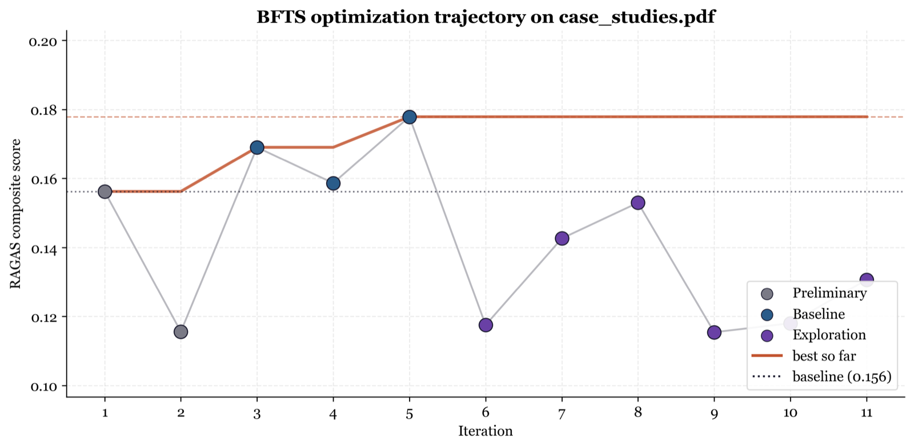
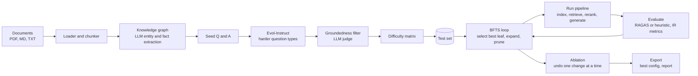

# RAG Optimizer

An agent that builds a test set from your own documents and searches RAG settings (chunking, retrieval, reranking, prompting) for the configuration that scores best on them.

## Why

Most teams that put an assistant on top of their documents pick chunk sizes, retrieval depth and prompt style by copying defaults, then check a few answers by eye. There is usually no test set, so nobody knows whether answers are grounded in the documents until users complain, and every tuning round costs engineer days. This project tries to make that a measurement step instead: generate questions from the documents, run each candidate pipeline against them, score the answers, and export the winning settings with their scores. It runs locally, with your own API key or a local model, so documents do not have to leave your machine.



*A small demo run: 11 configurations on one 18-page PDF with 5 hand-written questions. Despite the axis label, these scores come from the lexical fallback scorer, not the RAGAS LLM judge (see Results).*

## What it does

- Loads PDF, Markdown and text files and chunks them with configurable size and overlap.
- Generates a test set from the documents: knowledge-graph facts become seed questions, Evol-Instruct turns them into harder multi-context, reasoning and conditional questions, an LLM judge drops any that are not grounded in the source, and each question gets a difficulty grade.
- Runs a best-first tree search (adapted from Sakana AI's AI Scientist v2) over 432 pipeline configurations in four stages: preliminary, baseline, exploration and ablation.
- Scores each run with RAGAS (faithfulness, answer relevancy, context precision and recall) when it is available, and with a lexical heuristic otherwise, plus IR metrics (MRR, NDCG@k, P@k, R@k).
- Breaks results down by difficulty and question type, and compares configurations with paired bootstrap tests and Cohen's d.
- Exports the best configuration as JSON or YAML, a LangChain snippet, a trajectory CSV and a Markdown report.

## How it works



Each node in the search tree is one RAG configuration plus its score. The loop expands the highest-scoring leaf with a small change, retries or abandons failing nodes, moves through the four stages, and finishes by switching off each non-default component in turn to see which change carried the gain.

The LLM is chosen at runtime: Anthropic, OpenAI, or any OpenAI-compatible local server (Ollama, LM Studio, vLLM). With no provider configured it falls back to a mock LLM so the pipeline still runs end to end.

## Quick start

Python 3.10+.

```bash
git clone https://github.com/stanislavli3/rag-optimization-agent.git
cd rag-optimization-agent
python -m venv .venv && source .venv/bin/activate
pip install -r requirements.txt          # pulls PyTorch, transformers, Chroma (about 2 GB)
python -m spacy download en_core_web_sm
cp .env.example .env                     # set ANTHROPIC_API_KEY, or point LLM_BASE_URL at a local model
```

Run it from the command line:

```bash
# full pipeline: generate a test set, then search
python run.py --docs path/to/your/docs --experiments 15 --strategy bfts

# reuse an existing test set
python run.py --docs path/to/your/docs --testset path/to/testset.csv
```

Or use the Streamlit app (upload and test generation, optimization, results, export):

```bash
streamlit run app.py
```

To use a local model instead of an API key:

```bash
export LLM_BASE_URL=http://localhost:11434/v1
export LLM_MODEL=qwen2.5:7b-instruct
```

A React and D3 agent console (`frontend/`) with a Django backend (`backend/`) that streams search events over server-sent events is also in the repo and still being wired up: `python backend/manage.py migrate && python backend/manage.py runserver`, then `cd frontend && npm install && npm run dev`.

## Test-set generation in detail

1. **Knowledge graph extraction.** For each chunk, the LLM extracts entities, facts and relations. A `networkx` graph links chunks that share entities, following the RAGAS knowledge-graph approach (Es et al., 2024).
2. **Seed questions.** For each fact, the LLM writes a question and an answer conditioned only on the source chunk. Seeds it cannot answer from context are dropped.
3. **Evol-Instruct evolution.** Seeds are evolved into four types (WizardLM, 2023, as adapted by RAGAS):

   | Type | Description |
   |---|---|
   | Simple | Seed kept as is |
   | Multi-context | Needs two KG-connected passages |
   | Reasoning | Needs inference beyond the stated facts |
   | Conditional | The answer changes under a stated constraint |

   Default mix: simple 30%, multi-context 30%, reasoning 25%, conditional 15%.
4. **Groundedness filter.** An LLM judge checks that every claim in the answer is supported by the context; pairs below 0.7 confidence are rejected (quality gate from RAGEval).
5. **Difficulty matrix (GRADE style).** Each question is scored on reasoning depth (1, 2 or 3 hops) and semantic distance between question and context:

   | Difficulty | Criteria |
   |---|---|
   | Easy | depth 1 and distance < 0.3 |
   | Medium | depth 2 or distance 0.3 to 0.6 |
   | Hard | depth 3 or more, or distance > 0.6 |

## Search space

Defined in `config.py` (`RAG_SEARCH_SPACE`): 3 × 2 × 3 × 2 × 2 × 3 × 2 = 432 configurations.

| Parameter | Options |
|---|---|
| Chunk size (characters) | 256, 512, 1024 |
| Chunk overlap | 10%, 20% |
| Top-k | 3, 5, 10 |
| Reranker | none, cross-encoder (`ms-marco-MiniLM-L-6-v2`) |
| Search mode | vector only, hybrid (BM25 + vector) |
| Prompt style | zero-shot, few-shot, chain-of-thought |
| Embedding model | `all-MiniLM-L6-v2`, `BAAI/bge-small-en-v1.5` |

The BFTS stages:

| Stage | What happens |
|---|---|
| 1. Preliminary | `num_seeds` root configs run end to end |
| 2. Baseline | Expand from the best seed and tune basic parameters until scores stop improving |
| 3. Exploration | Best-first expansion: always expand the highest-scoring leaf |
| 4. Ablation | Disable each non-default component to measure its contribution |

## Evaluation

| Metric | What it measures |
|---|---|
| Faithfulness | Is every claim supported by the retrieved context? |
| Answer relevancy | Does the answer address the question? |
| Context precision | Are relevant chunks ranked higher? |
| Context recall | Does the context hold everything needed? |
| MRR, NDCG@k, P@k, R@k | Standard retrieval metrics |

Comparisons use paired bootstrap tests (10,000 resamples) and Cohen's d. When `ragas` is not installed or its judge calls fail, `src/evaluation/ragas_eval.py` falls back to a lexical heuristic so the pipeline keeps running offline.

## Tech stack

| Layer | Technology |
|---|---|
| UI | Streamlit and Plotly; React, D3 and rough.js agent console |
| Backend for the console | Django, server-sent events |
| LLM | Anthropic, OpenAI or an OpenAI-compatible local server (Ollama, LM Studio, vLLM), via LangChain |
| Embeddings | `all-MiniLM-L6-v2`, `BAAI/bge-small-en-v1.5` (sentence-transformers) |
| Retrieval | ChromaDB + BM25 (rank-bm25), cross-encoder reranker |
| Knowledge graph | networkx + spaCy |
| Evaluation | RAGAS, custom IR metrics, scipy statistics |

## Project structure

```
rag-optimization-agent/
├── config.py                  # Config, BFTSConfig, RAG_SEARCH_SPACE
├── run.py                     # CLI entry point
├── app.py                     # Streamlit UI
├── requirements.txt
├── src/
│   ├── ingest/                # loader.py, chunker.py
│   ├── testgen/               # knowledge_graph, seed_generator, evol_instruct,
│   │                          # groundtruth, difficulty_matrix, pipeline, llm
│   ├── pipeline/              # indexer, retriever, generator, runner
│   ├── evaluation/            # ragas_eval, ir_metrics, statistics
│   ├── optimizer/             # tree_node, search_space, experiment_manager,
│   │                          # ablation, bfts_loop
│   └── visualization.py       # Plotly figure builders
├── backend/                   # Django app for the agent console (SSE event stream)
├── frontend/                  # React + D3 agent console and landing page
├── notebooks/                 # 01 to 06: ingest, testgen, pipeline, eval, BFTS, end to end
└── tests/
```

## Results

One small demo, not a benchmark. On a single 18-page PDF with 5 hand-written questions, the search ran 11 of the 432 configurations. The best (1,024-character chunks instead of 512, everything else default) scored 0.178 against 0.156 for the default, about 14% higher, as shown in the chart above.

Read that number with care. The RAGAS judge calls kept hitting API rate limits, so the scores come from the lexical fallback scorer, all of them are below 0.2 out of 1, and the same configuration scored 0.169 on an earlier iteration, so run-to-run noise is close to the size of the gain. A proper evaluation would use the generated test set, more questions and several runs per configuration.

## Background

Started as a project for a Deep and Generative Learning course (spring 2026) and built solo by Stanislav Li. It draws on:

| Work | What it contributes here |
|---|---|
| AI Scientist v2 (Sakana AI) | Agentic best-first tree search, adapted to RAG configuration |
| RAGAS (EACL 2024) | Evaluation metrics and knowledge-graph test generation |
| WizardLM / Evol-Instruct (2023) | LLM-driven question evolution |
| GRADE (EMNLP 2025) | Two-axis difficulty matrix for RAG evaluation |
| AutoRAG-HP (EMNLP 2024) | Prior work on automated RAG tuning |
| RAGSmith (2025) | Prior work on search over large RAG configuration spaces |

## References

1. Lewis, P., et al. (2020). "Retrieval-Augmented Generation for Knowledge-Intensive NLP Tasks." *NeurIPS 2020*.
2. Es, S., et al. (2024). "RAGAs: Automated Evaluation of Retrieval Augmented Generation." *EACL 2024*.
3. Yamada, Y., et al. (2025). "The AI Scientist-v2: Workshop-Level Automated Scientific Discovery via Agentic Tree Search." *arXiv:2504.08066*.
4. Xu, C., et al. (2023). "WizardLM: Empowering Large Language Models to Follow Complex Instructions." *ICLR 2024*. *(Evol-Instruct)*
5. Asai, A., et al. (2024). "Self-RAG: Learning to Retrieve, Generate, and Critique through Self-Reflection." *ICLR 2024*.
6. Liu, N., et al. (2024). "Lost in the Middle: How Language Models Use Long Contexts." *TACL*.
7. NVIDIA (2025). "Finding the Best Chunking Strategy for Accurate AI Responses." *NVIDIA Technical Blog*.
8. Anthropic (2024). "Introducing Contextual Retrieval." *anthropic.com*.
9. Khattab, O., et al. (2024). "DSPy: Compiling Declarative Language Model Calls into Self-Improving Pipelines." *ICLR 2024*.

Landing page: [rag-optimization-agent.vercel.app](https://rag-optimization-agent.vercel.app)

## License

MIT. See [LICENSE](LICENSE).
